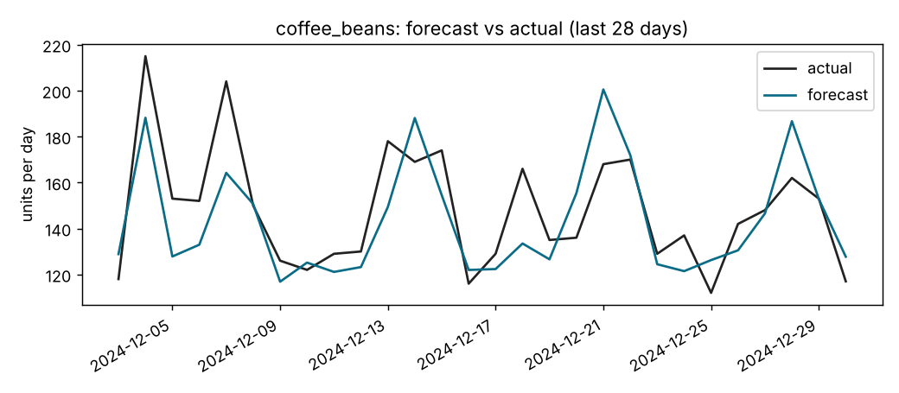

# sales-demand-forecasting

[](https://github.com/IslamRegradj/sales-demand-forecasting/actions/workflows/tests.yml)


Forecast daily product demand with time-series models, test the forecasts honestly on the past, and turn them into a **stock recommendation** (safety stock and reorder point) for each product.

Real sales data is private, so the project includes a generator of synthetic daily sales: a slow upward trend, busier weekends, a yearly season and occasional promotions. You can also run it on your own CSV file.



## How it works

1. **Data**: `forecasting/data.py` generates three years of daily sales for three products, or loads your CSV (`date`, `product`, `units`, and an optional `promo` column).
2. **Models**: `forecasting/models.py` compares:
   - **Weekday average**: the baseline. It predicts the average of the last four same weekdays. Any serious model has to beat it.
   - **Gradient boosting**: scikit-learn's `HistGradientBoostingRegressor` with calendar features, promotions and lagged sales (28, 35 and 364 days back, plus a 28-day rolling mean). All lags are at least 28 days, so one model forecasts up to 28 days ahead directly, without feeding its own predictions back in.
   - **Prophet**: added automatically when the `prophet` package is installed.
3. **Backtest**: `forecasting/evaluate.py` runs a rolling-origin backtest. Each window is forecast with a model trained only on the data before it, so nothing leaks from the future. Metrics are MAE, RMSE and WAPE (total error divided by total sales, which stays defined on days with zero sales).
4. **Stock planning**: `forecasting/inventory.py` computes, for each product, the safety stock from the forecast errors and the **reorder point** (expected demand during the supplier lead time plus safety stock).

## Quick start

```bash
git clone https://github.com/IslamRegradj/sales-demand-forecasting.git
cd sales-demand-forecasting
pip install -r requirements-dev.txt
python -m forecasting.run
```

To add Prophet to the comparison, install it too (the installation can take a few minutes):

```bash
pip install -r requirements-prophet.txt
```

Options:

```bash
python -m forecasting.run --horizon 28 --folds 4 --lead-time 10 --service-level 0.97
python -m forecasting.run --csv my_sales.csv
```

The command prints the backtest results and the stock recommendations, and saves `metrics.csv`, `stock_recommendations.csv` and one forecast plot per product in the `results/` folder.

## Example results

Output of the command above (without Prophet; the numbers can change slightly with your package versions):

```text
Backtest results (lower is better):
     product             model    MAE   RMSE  WAPE
coffee_beans   weekday-average 18.004 21.981 0.114
coffee_beans gradient-boosting 14.670 18.635 0.093
    notebook   weekday-average 11.330 14.151 0.151
    notebook gradient-boosting 10.396 12.692 0.138
   usb_cable   weekday-average  6.545  8.628 0.144
   usb_cable gradient-boosting  6.788  8.494 0.149

Stock recommendations (lead time 7 days, service level 95%):
     product             model  forecast_next_7_days  safety_stock  reorder_point
coffee_beans gradient-boosting                   991            80           1071
    notebook gradient-boosting                   540            55            595
   usb_cable   weekday-average                   339            38            377
```

Gradient boosting beats the baseline on two of the three products. On `usb_cable`, whose sales are small and noisy, the simple baseline is slightly better, so the script picks the better model for each product separately. A fancy model is not always worth it, and the backtest is how you find out.

## Reading the stock recommendation

- **Safety stock** = z × forecast error (standard deviation) × √lead time. Here z comes from the service level: 95% gives z = 1.645.
- **Reorder point** = forecast demand during the lead time + safety stock. When stock falls to this level, place a new order.
- A worse forecast means a larger safety stock, so improving the model directly reduces the stock you need to hold.

## Tests and code quality

```bash
python -m pytest                        # tests
ruff check . && ruff format --check .   # lint and formatting
mypy                                    # type checking
```

The same checks run automatically on every push with GitHub Actions.

The tests cover the data generator, the error metrics on known values, the models (including that forecasts are never negative and that gaps or a wrong start date are rejected), the backtest windows (no overlap, always after the training data), the stock formulas, and the command line from start to finish.

## Project structure

```text
forecasting/
  data.py        synthetic sales generator and CSV loader
  models.py      weekday average, gradient boosting, Prophet
  evaluate.py    metrics and rolling backtest
  inventory.py   safety stock and reorder point
  run.py         command line: compare models and plan stock
tests/           pytest tests
docs/            example plot
.github/         continuous integration (lint, types, tests)
pyproject.toml   settings for pytest, ruff and mypy
```

## Limitations and next steps

- The data is synthetic. Real sales have holidays, stock-outs (zero sales caused by no stock, not by no demand), price changes and sudden shocks.
- Future promotions are assumed to be known in advance, and the stock plan assumes none are planned.
- The safety stock formula assumes forecast errors are roughly normal and independent from day to day.
- Forecasts are limited to 28 days, and products are modelled one at a time.
- An LSTM neural network is not included. It would be an interesting comparison, but with a few years of daily data it often does not beat gradient boosting or Prophet.
